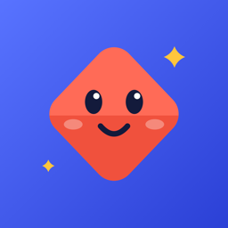
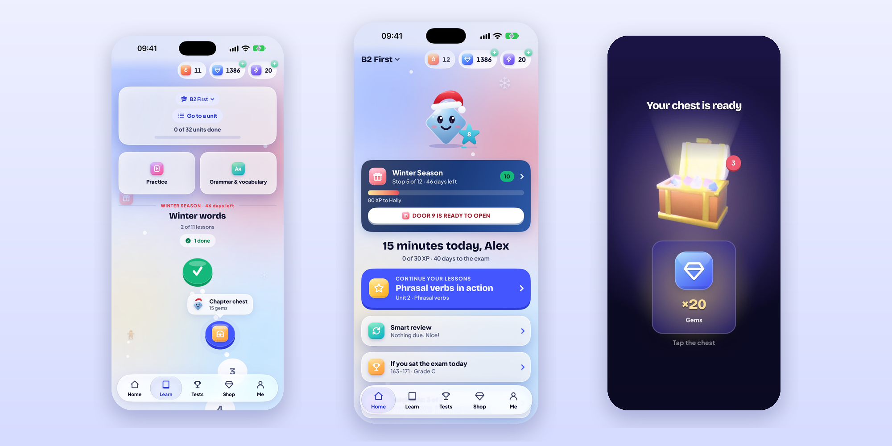
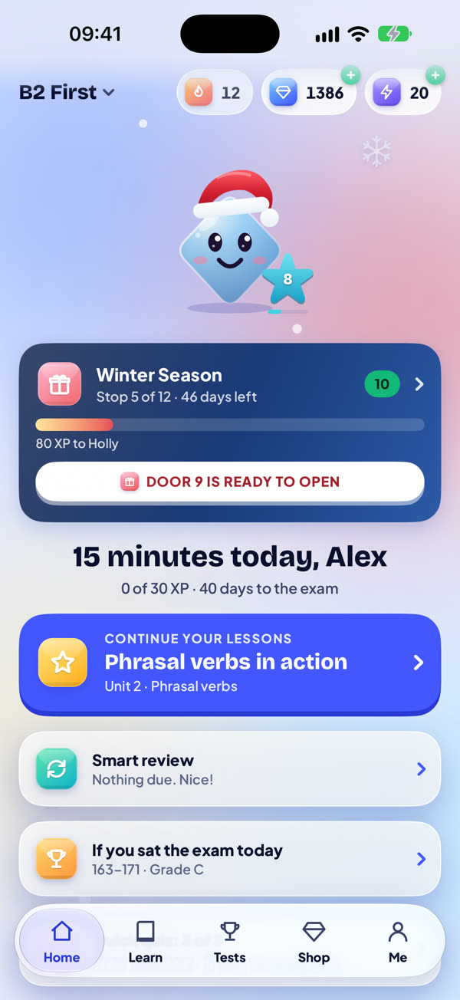
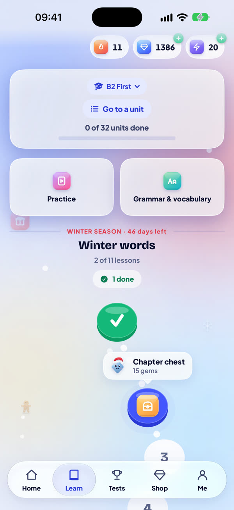
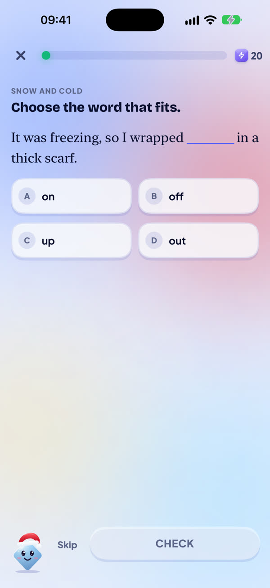
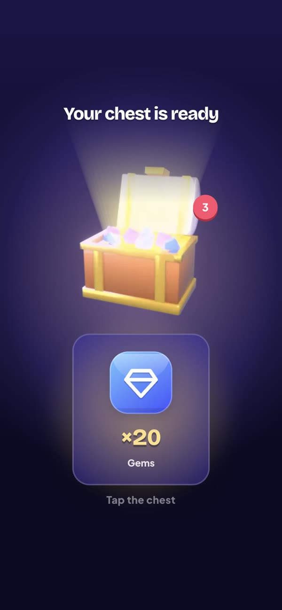
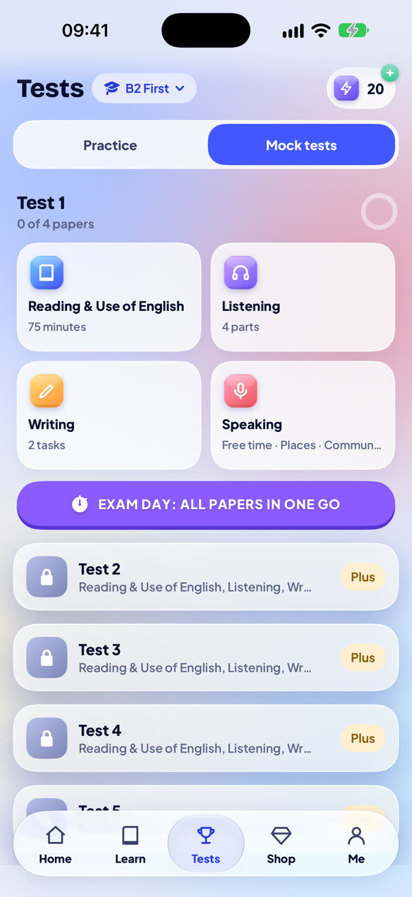
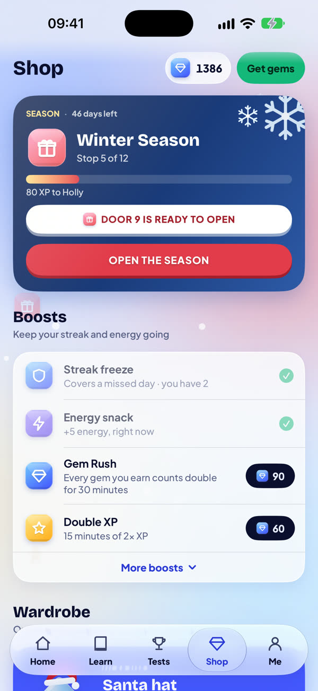
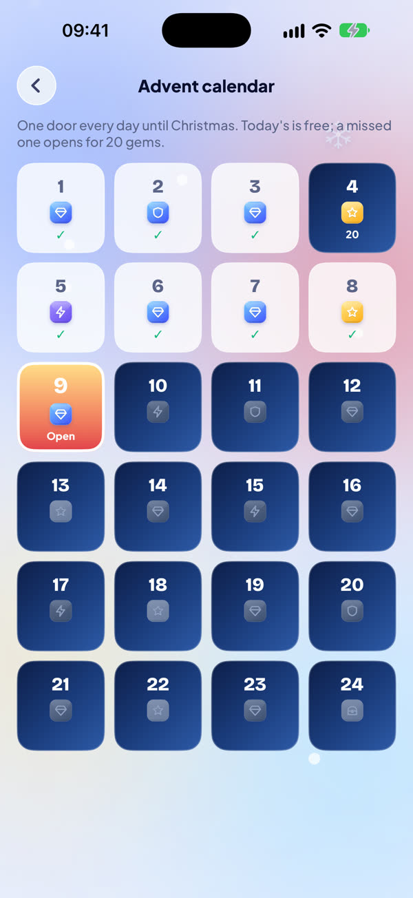
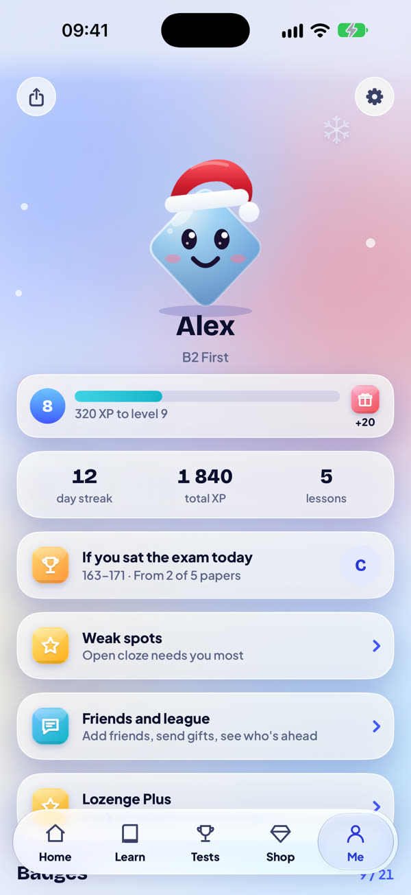

  

<h1 align="center">Lozenge</h1>

  <b>Practice for the Cambridge English exams, a few minutes at a time.</b> 
  <a href="https://lozenge.online/">lozenge.online</a> 
  B1 Preliminary · B2 First · C1 Advanced 
  Version 2.4.1 · November 2026

  
  
  
  
  

  

Lozenge is a practice app for the Cambridge English exams, made by a student from Czechia. Most apps
teach general English, and most exam books aren't much fun, so Lozenge tries to do both: short lessons
you can do on the bus, and full timed tests that look like the real papers.

Lessons use the same task types as the exam (gap fills, word formation, key word transformations and so
on). Every mock test gives you a score on the Cambridge English Scale, and Home shows the grade you'd get
if you sat the exam today – and which paper would gain you the most.

There's also a streak, gems and a mascot called Lozzy you can dress up, so there's a small reason to come
back tomorrow.

## What's in it

You pick one exam and the lessons, tests and daily plan follow it.

| | Reading &amp; Use of English | Listening | Writing | Speaking | Lesson units | Pass mark |
|---|:---:|:---:|:---:|:---:|:---:|:---:|
| **B1 Preliminary** | 10 mock papers + practice sets | 10 tests + practice sets | 10 papers · 32 tasks | 10 tests | 23 | 140 |
| **B2 First** | 10 mock papers + practice sets | 10 tests + practice sets | 10 papers · 45 tasks | 10 tests + practice sets | 32 | 160 |
| **C1 Advanced** | 10 mock papers + practice sets | 10 tests + practice sets | 10 papers · 42 tasks | 10 tests | 23 | 180 |

Over 4,000 exam-style questions, about 1,400 recordings and 150 listening reels. All the texts and exercises
are written from scratch in the exam format; nothing is copied from Cambridge. The recordings use synthetic
British voices.

**New in 2.4.1**

- **Works offline.** On Wi-Fi the app downloads every recording, video and photo by itself, so lessons and
  tests work on a plane or underground. Lessons you finish offline stay done.
- **Reward chests.** Tap the chest, watch it open, then tap again for each reward: gems, boosts, streak
  freezes, golden words, examiner's secrets, golden tickets and outfits for Lozzy you can only find in chests.
  Your finds are kept in the Treasure collection.
- **A chest for tomorrow.** Finish your first day and a chest waits for you the next morning.
- **Seasons.** Winter Season with an advent calendar, a road of rewards and a word album to fill.

**Everything else**

- **Mock tests and Exam day** – timed papers with the real parts and questions, or a whole test in one go,
  in the real order with breaks, ending with one overall grade. A strict exam mode runs it like the real day.
- **A live AI examiner** (Plus) – a spoken conversation with Anna, the examiner, or Speaking Part 3 with
  Tom, another candidate, like on the day. Your speaking is then marked on the official criteria.
- **Writing, marked** – essays, emails, articles and reviews marked on the four official criteria, with
  corrections and a stronger version of your own text. Wrote it by hand? Take a photo.
- **“Why?”** – tap it under a wrong answer and the mistake is explained in your language.
- **Speaking practice** – exam-style photos, your pace, pauses and range, and the words to practise saying.
- **Listening reels** – short scenes with British voices and video; save new words from the transcript.
- **Exam guides** – how to write each task and handle every Speaking part, card by card, read aloud.
- **Your goal and your week** – choose a pass, Grade B or Grade A; Home shows how far you are, and every
  Sunday you get your week in numbers.
- **Classes** – a teacher creates a class and shares its code; students join and the teacher sees each
  student's predicted score and weakest paper (never their answers).
- **Smart review** – every mistake comes back right before you'd forget it.
- The interface is in 16 languages, including Czech, Slovak, Turkish and Ukrainian. The exam material
  stays in English.

## Screenshots

<table>
  <tr>
    <td align="center"> Home</td>
    <td align="center"> Your path</td>
    <td align="center"> Lessons</td>
    <td align="center"> Reward chests</td>
  </tr>
  <tr>
    <td align="center"> Mock tests</td>
    <td align="center"> Shop</td>
    <td align="center"> Advent calendar</td>
    <td align="center"> Your progress</td>
  </tr>
</table>

## Install

**Android (Google Play test)** – help test Lozenge before it's on Google Play for everyone:

1. Join this group: [groups.google.com/g/lozenge-testers](https://groups.google.com/g/lozenge-testers)
2. Then opt in here: [play.google.com/apps/testing/com.marekkalivoda.lozenge](https://play.google.com/apps/testing/com.marekkalivoda.lozenge)
   – and install Lozenge from Google Play.

Use the same Google account for both steps. Rather not use Google Play? Download
[`Lozenge.apk`](https://github.com/Entexik/lozenge-app/releases/latest/download/Lozenge.apk) instead
(Android 8.0 or newer); uninstall it before you install the Google Play version.

**iPhone** – join the public beta on TestFlight: [testflight.apple.com/join/Vr9PM1Qp](https://testflight.apple.com/join/Vr9PM1Qp)
(install Apple's TestFlight app first), or get it from the [App Store](https://apps.apple.com/app/id6819167082).
Widgets, Live Activities and an Apple Watch app are included.

**Anything else** – there's a web version here: [lozenge.online/app](https://lozenge.online/app/).

**Web** – [try it in your browser](https://lozenge.online/app/). Everything that's free in
the app is free there too.

What changed in each version: [releases](https://github.com/Entexik/lozenge-app/releases).

## Česky

Lozenge je aplikace na přípravu ke zkouškám Cambridge B1 Preliminary, B2 First a C1 Advanced. Dělá ji
student z Česka. Jsou v ní krátké lekce, zkušební testy na čas a Den zkoušky s celkovou známkou, živý
AI zkoušející (i s druhým kandidátem v Part 3), psaní s hodnocením (i z fotky ručně psaného textu),
vysvětlení chyb česky, poslechové reels, průvodci zkouškou a třídy pro učitele. Funguje i offline,
nahrávky se stáhnou na Wi‑Fi. Rozhraní je česky.
[iPhone (TestFlight)](https://testflight.apple.com/join/Vr9PM1Qp) ·
[APK pro Android](https://github.com/Entexik/lozenge-app/releases/latest/download/Lozenge.apk) ·
[verze do prohlížeče](https://lozenge.online/app/)

## Feedback

If you find a wrong answer in an exercise or something that doesn't work, please [open an issue](https://github.com/Entexik/lozenge-app/issues) or tell us on [Discord](https://discord.gg/3fZpk2kzp). It helps a lot.

---

Lozenge is an independent practice app and isn't affiliated with Cambridge University Press &amp; Assessment.
All texts, recordings and exercises are original. [Privacy policy](https://lozenge.online/privacy.html) · © 2026 Lozenge. All rights reserved.
